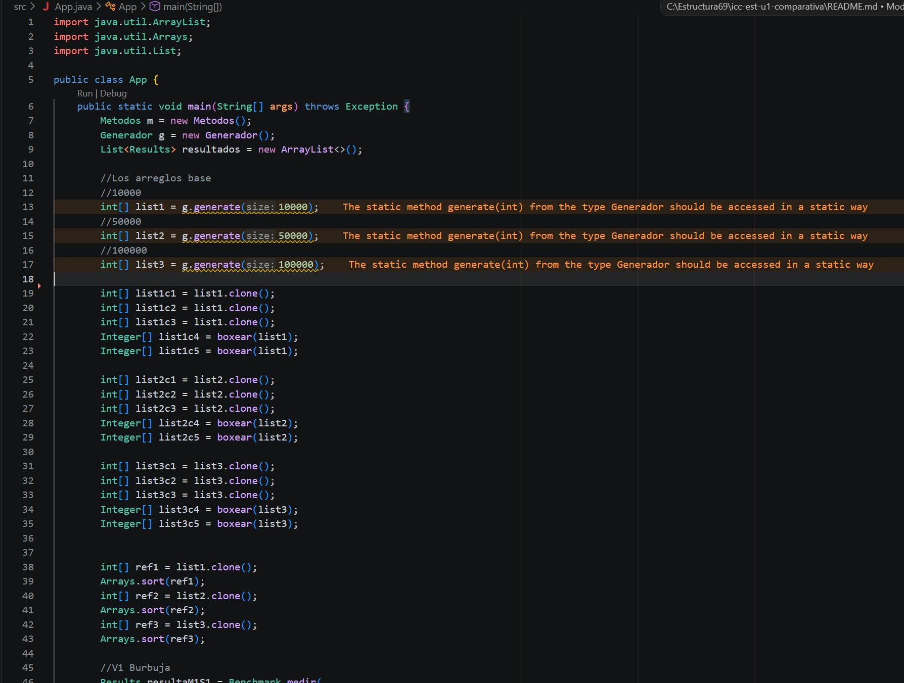
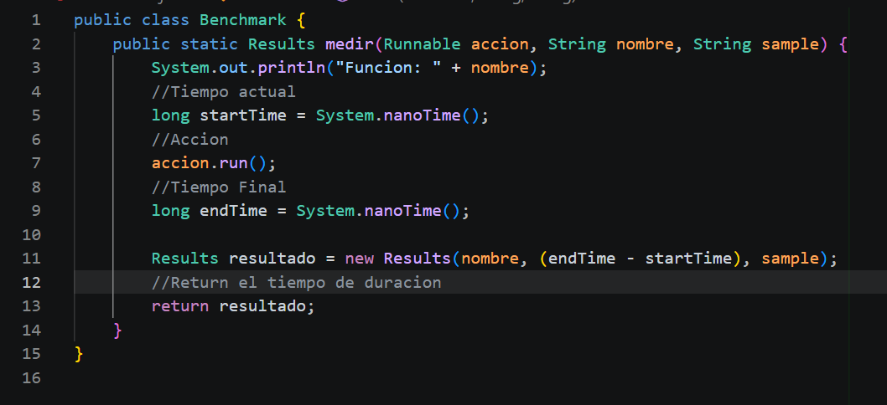
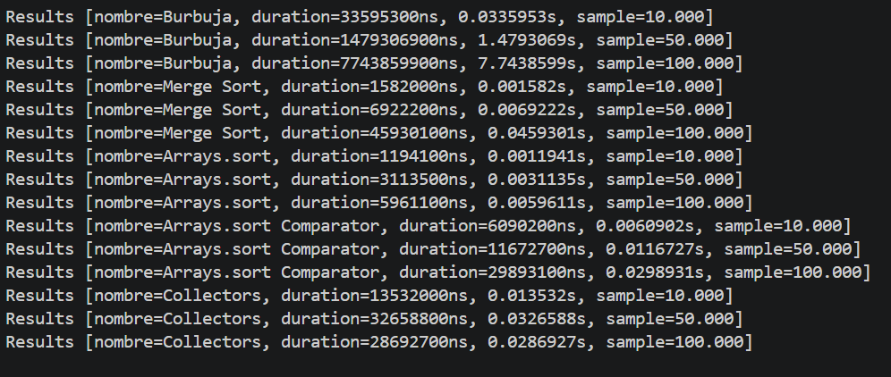

# Investigación: comparación de métodos de ordenamiento

**Asignatura:** Estructura de Datos
**Tema:** 1.1 Ordenamiento directo · Java
**Unidad 4:** Ordenamiento, búsqueda y recursividad
**Docente:** Ing. Pablo Torres, Mgtr.
**Estudiante:** Evelyn Mayancela

---

## 1. Objetivo

Ver cuánto se demora cada método de ordenamiento con 10.000, 50.000 y 100.000 números y comparar los tiempos.

## 2. Cómo lo hice

- Con la clase `Generador` hice tres arreglos con números al azar.
- A cada método le di una copia del mismo arreglo, para que todos ordenen lo mismo.
- El tiempo lo medí con `System.nanoTime()` en la clase `Benchmark`.
- Después de ordenar, `verificar` compara el resultado con `Arrays.sort` para ver que quedó bien.
- Cada prueba la corrí una sola vez.

**Código de `App`**

**Código de `Benchmark`**

## 3. Métodos

- **Burbuja:** compara dos números seguidos y los cambia si están al revés. Se repite hasta que todo queda ordenado. Es lento con muchos datos (O(n²)).
- **Merge Sort:** divide el arreglo en mitades, ordena cada una y después las junta. Es mucho más rápido (O(n log n)).
- **Arrays.sort:** el método que ya trae Java para `int[]`.
- **Arrays.sort con Comparator:** lo mismo pero con `Integer[]` y un Comparator.
- **Collectors:** usa streams para ordenar y luego pasa los datos de vuelta al arreglo.

## 4. Resultados

Tiempos en segundos:

| Método | 10.000 | 50.000 | 100.000 |
|---|---|---|---|
| Burbuja | 0,0336 | 1,4793 | 7,7439 |
| Merge Sort | 0,0016 | 0,0069 | 0,0459 |
| Arrays.sort | 0,0012 | 0,0031 | 0,0060 |
| Arrays.sort Comparator | 0,0061 | 0,0117 | 0,0299 |
| Collectors | 0,0135 | 0,0327 | 0,0287 |

**Consola**

## 5. Análisis

- La burbuja fue la más lenta. Con 100.000 números se demoró 7,74 s y Merge Sort solo 0,046 s, o sea más de 100 veces más rápido.
- Cuando hay más datos la burbuja se demora mucho más. De 50.000 a 100.000 el tiempo se multiplicó por 5 más o menos.
- `Arrays.sort` con `int[]` fue el más rápido en todos los tamaños.
- Comparator y Collectors fueron más lentos que `Arrays.sort` porque usan `Integer[]` (objetos), pero igual son mucho más rápidos que la burbuja.
- Mi Merge Sort funciona bien, pero es más lento que `Arrays.sort`.
- Algo raro: Collectors con 100.000 salió más rápido que con 50.000. Creo que fue porque cada prueba la corrí una sola vez y la computadora estaba haciendo otras cosas. Los tiempos cambian un poco en cada ejecución.

## 6. Conclusión

- La burbuja sirve para aprender, pero no para muchos datos.
- Merge Sort y los métodos de Java ordenan 100.000 números en menos de 0,05 s.
- Lo mejor es usar `Arrays.sort`.